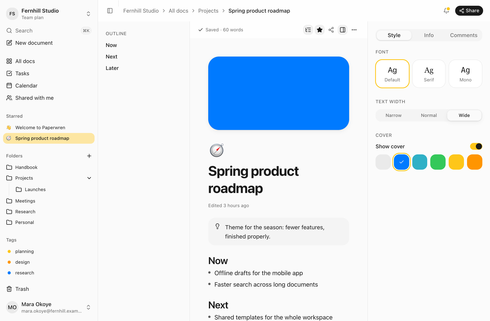
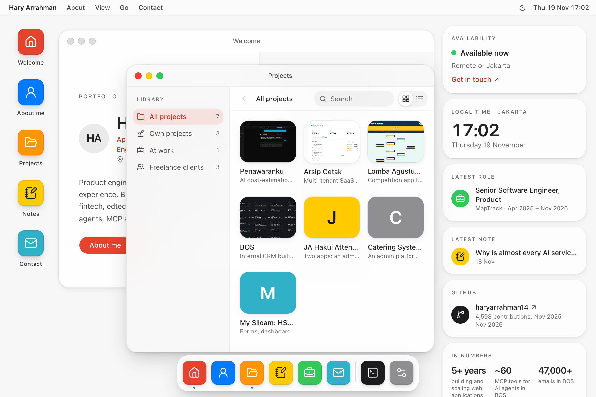
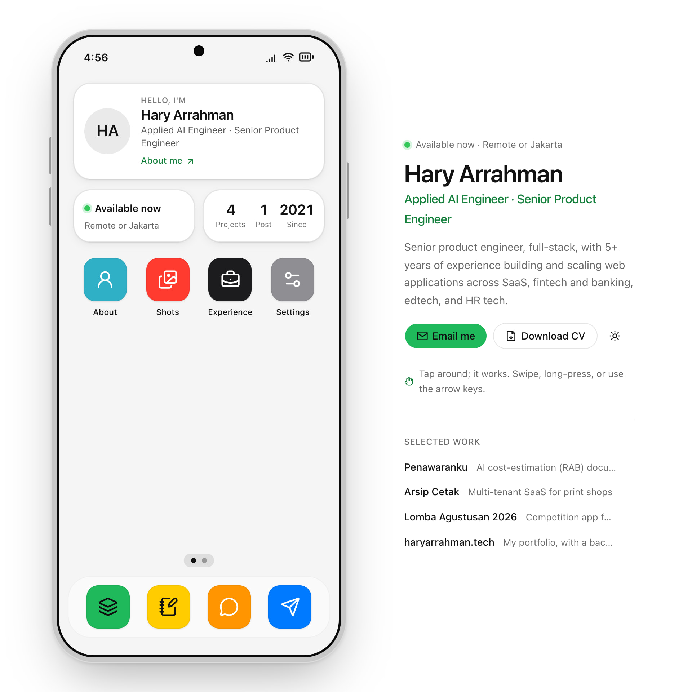
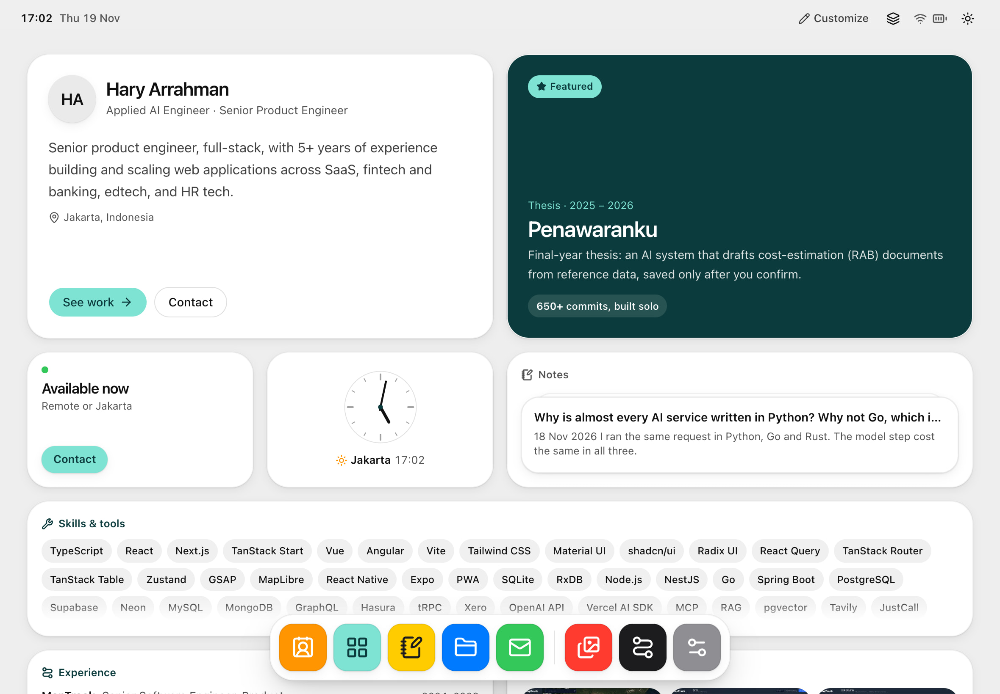
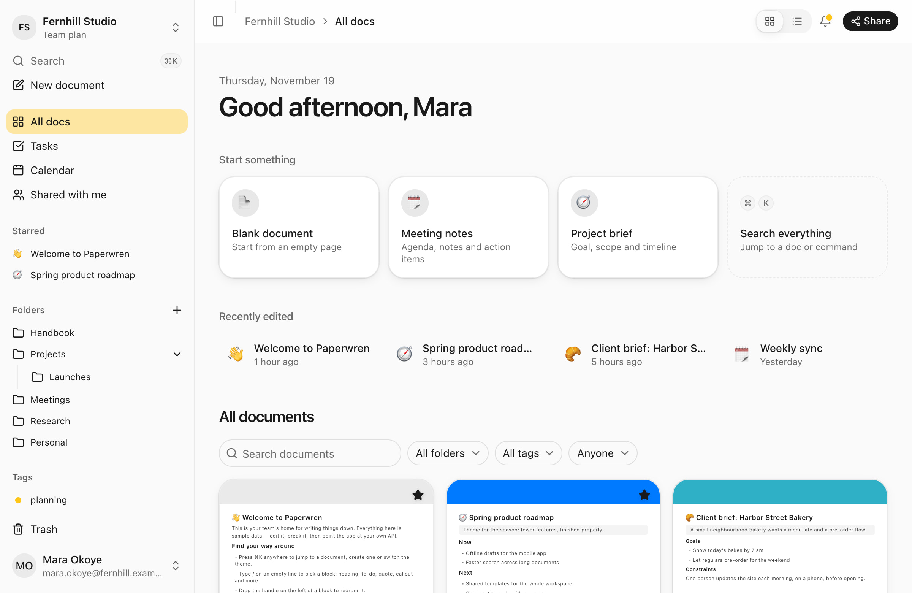
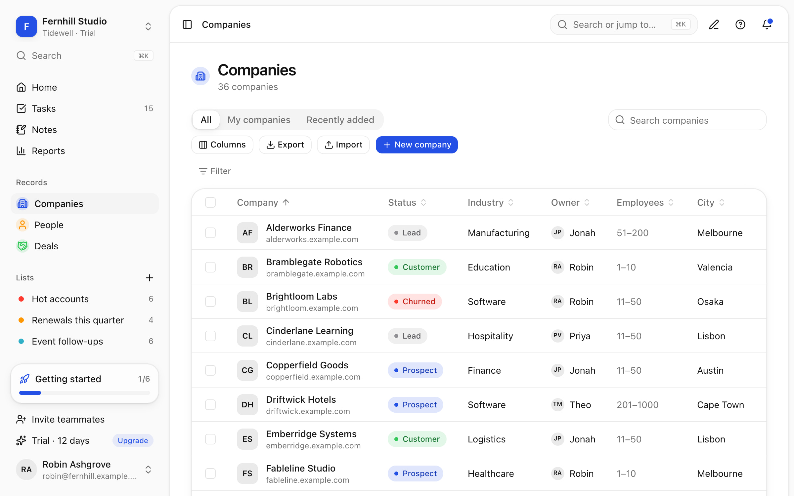
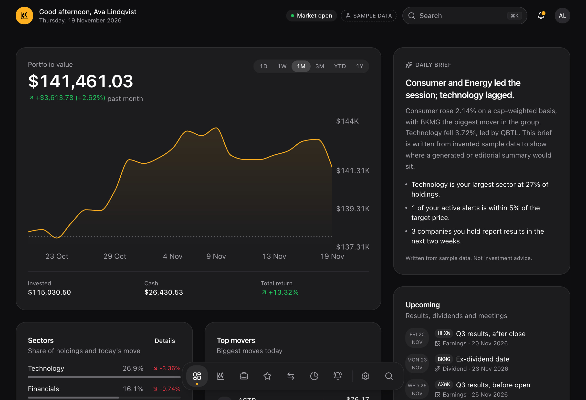

# App Templates

Six React templates you can open, click through and take. Three portfolios shaped like devices, three web apps shaped like the products most teams build. Each one has a live preview and an article on how it was designed.



## Templates

| | Template | What it is | Preview | Read | Code |
|---|---|---|---|---|---|
| 01 | Desktop portfolio | A portfolio that looks like a laptop desktop | [Open](https://desktop.blog.haryarrahman.tech) | [Article](https://haryarrahman.tech/blog/portfolio-as-a-laptop-desktop) · [Indonesian](https://haryarrahman.tech/blog/portofolio-berbentuk-desktop-laptop) | [`apps/portfolio-desktop/`](apps/portfolio-desktop/) |
| 02 | Phone portfolio | A portfolio that looks like a phone | [Open](https://phone.blog.haryarrahman.tech) | [Article](https://haryarrahman.tech/blog/portfolio-as-a-phone) · [Indonesian](https://haryarrahman.tech/blog/portofolio-berbentuk-ponsel) | [`apps/portfolio-phone/`](apps/portfolio-phone/) |
| 03 | Tablet portfolio | A portfolio that looks like a tablet home screen | [Open](https://tablet.blog.haryarrahman.tech) | [Article](https://haryarrahman.tech/blog/portfolio-as-a-tablet-home-screen) · [Indonesian](https://haryarrahman.tech/blog/portofolio-berbentuk-layar-tablet) | [`apps/portfolio-tablet/`](apps/portfolio-tablet/) |
| 04 | Paperwren | Documents and notes workspace | [Open](https://paperwren.blog.haryarrahman.tech) | [Article](https://haryarrahman.tech/blog/documents-workspace-template) · [Indonesian](https://haryarrahman.tech/blog/template-workspace-dokumen) | [`apps/app-workspace/`](apps/app-workspace/) |
| 05 | Tidewell | CRM and business admin | [Open](https://tidewell.blog.haryarrahman.tech) | [Article](https://haryarrahman.tech/blog/crm-admin-template) · [Indonesian](https://haryarrahman.tech/blog/template-admin-crm) | [`apps/app-crm/`](apps/app-crm/) |
| 06 | Ledgerfinch | Finance dashboard that starts in dark mode | [Open](https://ledgerfinch.blog.haryarrahman.tech) | [Article](https://haryarrahman.tech/blog/dark-finance-dashboard-template) · [Indonesian](https://haryarrahman.tech/blog/template-dashboard-keuangan-gelap) | [`apps/app-finance/`](apps/app-finance/) |

## The portfolios

All three show the same person. They read one content package, so you write your profile once and get three shapes.

**01 · Desktop.** Menu bar, dock, windows you can drag, widgets, notes and a small terminal.



**02 · Phone.** Lock screen, home screen with widgets, and apps that open full screen.



**03 · Tablet.** A widget grid you can reorder, a dock, and apps that open side by side.



## The web apps

Every screen works with made-up sample data. Nothing calls a network, and no sign-in is asked.

**04 · Paperwren.** Folders, a document grid and table, a block editor, tasks, calendar and settings.



**05 · Tidewell.** Data tables with filters and bulk actions, record pages, a deals board, reports and settings.



**06 · Ledgerfinch.** Portfolio overview, screener, a page per instrument, watchlists, transactions and alerts.



Each web app also has an app shell, a command palette (⌘K), forms checked with zod, and loading, empty, error and not-found states.

## Hand it to your AI

The fastest way to make one yours. Open Claude Code, Cursor or another coding agent in an empty folder and paste this. Change the folder to the template you want.

```text
Set up a project from a template for me.

1. Clone https://github.com/haryarrahman14/app-templates
2. Read AGENTS.md at the repo root: it says where every change goes.
   docs/design-system.md has the colours, type and spacing.
3. I want the template in apps/app-crm.
   Keep that folder and packages/ui; remove the other apps.
   (For a portfolio, keep packages/content too.)
4. Turn it into my app.
   Name: <your product>. What it does: <one line>. Accent colour: <a colour>.

Ask me for anything you need before you start. Then run it locally and show me.
```

[`AGENTS.md`](AGENTS.md) tells the agent where the name, the colour, the content and the deploy address live.

## Run it

Needs Node 24.

```sh
nvm use                 # Node 24
corepack enable pnpm    # once; pnpm is pinned in package.json
pnpm install
pnpm --filter app-crm dev
```

| Template | Command | Address |
|---|---|---|
| 01 Desktop | `pnpm --filter portfolio-desktop dev` | http://localhost:3001 |
| 02 Phone | `pnpm --filter portfolio-phone dev` | http://localhost:3002 |
| 03 Tablet | `pnpm --filter portfolio-tablet dev` | http://localhost:3003 |
| 04 Paperwren | `pnpm --filter app-workspace dev` | http://localhost:3004 |
| 05 Tidewell | `pnpm --filter app-crm dev` | http://localhost:3005 |
| 06 Ledgerfinch | `pnpm --filter app-finance dev` | http://localhost:3006 |

## Make it yours by hand

1. **Keep one template.** Keep `apps/<name>` and `packages/ui`, delete the other apps. A portfolio also needs `packages/content`.
2. **Replace the content.** Portfolios: the data in `packages/content`. Web apps: each feature reads through `src/features/<feature>/api/queries.ts`, so swap those functions for your API.
3. **Set your colour.** Change `--tint` in the app's `src/styles/app.css`.
4. **Turn sign-in on, if you need it.** Set `REQUIRE_SIGN_IN` in `src/lib/session.ts` and search for `PLUG REAL AUTH HERE`.

Each app's own README lists its screens and the exact files to change.

## What is inside

| | |
|---|---|
| Framework | React 19, TypeScript, TanStack Start (every template builds to static files) |
| Data and tables | TanStack Query, TanStack Table |
| Forms | react-hook-form, with zod for every schema |
| UI | Tailwind v4, shadcn/ui on Radix in `packages/ui`, lucide icons, motion |
| Tooling | pnpm, turbo, biome |

Every app has the same folders, sorted by feature:

```
apps/<app>/src/
  routes/               thin route files: one page component each
  features/<feature>/   api/  components/  hooks/  utils/  types/  schemas/  constants/
  components/kit/       the app's own design kit, built on packages/ui
  components/layout/    the app shell
  lib/                  helpers shared by features
packages/ui/            shared components, light and dark tokens
packages/content/       the portfolios' content
```

## Rules of the repo

- The designs are original. They take ideas from familiar products and use none of their names, logos, icons or colours.
- Colours are mostly neutral, with one accent per app. Every value is in [`docs/design-system.md`](docs/design-system.md).
- The sample content in `packages/content` is my own profile. Replace it before you publish yours.
- Each template can go online as static files on a free Cloudflare Worker: [`docs/deploy-cloudflare.md`](docs/deploy-cloudflare.md).

MIT licensed. If a template saved you time, a star helps other people find it.

Articles: [haryarrahman.tech/blog](https://haryarrahman.tech/blog)
