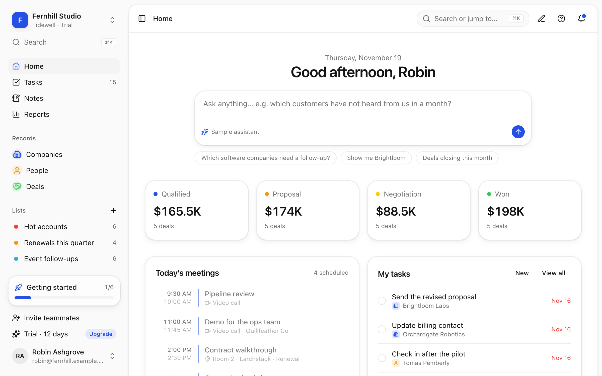

# Tidewell — CRM template

A business/admin/CRM app, built as a static single-page app on TanStack Start: grouped sidebar, home with an ask
box, data tables, record pages, a deal pipeline, tasks, notes, reports, an email composer and settings. Everything runs against in-memory
sample data (a fictional workspace, invented companies and people), so you can click through it all and then
swap in your own API.



## Run it

```sh
source ~/.nvm/nvm.sh && nvm use 24
pnpm install
pnpm --filter app-crm dev        # http://localhost:3005
pnpm --filter app-crm typecheck
pnpm --filter app-crm build      # static files in dist/client (shell: dist/client/index.html)
pnpm --filter app-crm preview:cf # build, then serve dist/client with wrangler dev
pnpm --filter app-crm deploy     # build, then upload to Cloudflare
```

It is static files only: there is no server code and no Worker runs per request. The build writes one shell page,
`dist/client/index.html`, and `wrangler.jsonc` serves `dist/client` as assets with
`not_found_handling: "single-page-application"`, so any address gets the shell and the router takes it from there
in the browser. Any static host works the same way if it falls back to `index.html`.

No sign-in is asked: you start as the sample user (see "Sign-in is off by default" below). Changes you make live in the
browser tab until you reload.

## Screens

| Route | What it shows |
|---|---|
| `/sign-in`, `/sign-up`, `/forgot-password`, `/reset-password` | Auth forms (react-hook-form + zod) |
| `/home` | Greeting, "ask anything" box (stub), pipeline cards, today's meetings, my tasks, recent activity |
| `/companies`, `/people` | Data tables: saved views, search, filter chips, sort, columns, selection + bulk bar, inline edit, CSV export, load more, "New" dialog. `?list=<id>` shows one list |
| `/companies/$id`, `/people/$id` | Record page: editable header and properties, tabs (Overview, Activity, Notes, Tasks, Deals, Files stub), related records |
| `/deals` | Kanban by stage (drag and drop, or the card's "Move to" menu), column totals, table view (`?view=table`), deal sheet (`?deal=<id>`) |
| `/tasks` | Filters (Mine, Due, Upcoming, Done, All), quick add, edit dialog, links to records |
| `/notes` | List + editor with autosave and a small markdown preview, linked record |
| `/reports` | KPI cards and four charts with a date range |
| `/settings/*` | Profile, Workspace, Members, Custom fields, Notifications, Billing, API keys, Danger zone |

Always available: command palette (⌘K / Ctrl+K), floating email composer, notifications, onboarding checklist
("Getting started"), CSV import wizard, keyboard shortcuts (`?`). Light and dark themes, phone layout (sidebar
becomes a sheet).

## Structure

```
src/
  routes/               thin routes: beforeLoad/loader/head + one page component (TanStack file routes)
    _auth.tsx, _auth/   sign in, sign up, forgot/reset password (redirects signed-in visitors to /home)
    _app.tsx, _app/     the shell and every app screen (redirects signed-out visitors to /sign-in)
  router.tsx            router + query client; default pending/error/not-found screens
  features/<feature>/   api/ (queries.ts, mutations.ts), components/, hooks/, schemas/, constants/, utils/
  components/kit/       app design kit, including data-table/ (the generic table)
  components/layout/    sidebar, top bar, global overlays (palette, composer, dialogs)
  lib/                  session stub, sample db, formatting, ui state, loader helper
```

URL state is validated route search params (zod): `?list=` on companies and people, `?view=` and `?deal=` on
deals, `?note=` on notes.

Features talk to each other only through `api/` and `schemas/` (their public surface) and through `lib/` and
`components/`. Record pages live in `features/records`, which composes companies, people, deals, notes, tasks and
activities.

## Plug in a real API

All data goes through TanStack Query. The only code that touches the sample data is in
`features/<feature>/api/queries.ts` and `api/mutations.ts`, marked with `▶`:

```ts
// features/companies/api/queries.ts
export const companiesQuery = queryOptions({
  queryKey: ["companies"],
  queryFn: () => fetch("/api/companies").then((r) => r.json()).then(companySchema.array().parse),
});
```

1. Replace each `queryFn` / `mutationFn` body with a call to your backend. Keep the zod `parse` so bad
   responses fail loudly. Optimistic updates (`onMutate` with `patchList`) keep working unchanged.
2. Delete `src/lib/sample-db/` and the `recordActivity` calls (your backend records activity itself).
3. The "ask anything" stub is `features/home/api/mutations.ts` (`ask`): post the question to your model and
   return `{ text, links }`. Email sending is marked in `features/email/components/email-composer.tsx`;
   settings data in `features/settings/api/`.

Route `loader`s call `ensureQueries(context.queryClient, ...queries)` from `lib/ensure-queries.ts`, so pages render
with data. Your API is called from the browser, so it needs CORS for the app's origin (or serve both from one).

## Plug in real auth

- `src/lib/session.ts` (marked `PLUG REAL AUTH HERE`) — `signIn` / `signOut` / `isSignedIn` keep a sample flag in
  localStorage. Replace them with your provider's browser SDK calls, and make `isSignedIn` read its session
  (current user, or a token whose expiry you check).
- `src/routes/_app.tsx` — `beforeLoad` redirects to `/sign-in?next=…` when `isSignedIn()` is false;
  `src/routes/_auth.tsx` sends signed-in visitors to `next` (or `/home`). They only call `isSignedIn`, so they
  keep working once it reads your provider. These guards only hide screens: protect the data in your API.
- `SESSION_MEMBER_ID` (the signed-in member) is used for "My …" views; read it from your session instead.
  `meQuery` in `features/workspace/api/queries.ts` should call your "current user" endpoint.

## Add a record type with the data-table kit

Example: "Projects".

1. **Schema** — `features/projects/schemas/project.ts` with `projectSchema` and a `newProjectSchema` form schema.
2. **API** — `features/projects/api/queries.ts` (`projectsQuery`) and `api/mutations.ts`
   (`useCreateProject`, `useUpdateProject`, `useDeleteProjects`); copy the companies versions.
3. **Columns** — `features/projects/hooks/use-project-columns.tsx`, modelled on
   `features/companies/hooks/use-company-columns.tsx`:

   ```tsx
   const column = dataTableColumnHelper<Project>();
   column.columns([
     selectionColumn<Project>(),
     column.accessor("name", { id: "name", meta: { label: "Project", filter: { kind: "text" } }, filterFn: "includesString" }),
     column.accessor("status", {
       id: "status",
       meta: { label: "Status", filter: { kind: "select", options: STATUS_OPTIONS } },
       filterFn: "inOptions",
       cell: ({ row }) => <EditableSelectCell value={row.original.status} options={STATUS_OPTIONS} label="status" onSave={…}>…</EditableSelectCell>,
     }),
   ]);
   ```

   `meta.label` names the column in menus, chips and CSV; `meta.filter` makes it filterable; `meta.align` and
   `meta.format` control alignment and CSV output.
4. **Page** — `features/projects/components/projects-page.tsx` renders
   `<DataTable data columns getRowId exportName views actions bulkActions empty />` (see `companies-page.tsx`),
   and a thin `src/routes/_app/projects.tsx` loads `projectsQuery` (`loader` + `head` + the page).
5. **Wire-up** — add `"project"` to `recordTypeSchema` and `RECORD_TYPES` in `src/lib/records.ts` (label, icon,
   glyph colours, path). The sidebar, command palette and record links read from there; add a "New project"
   dialog to `components/layout/global-overlays.tsx` if you want ⌘K "create".

The table's features (sorting, filtering, selection, visibility, ordering, pagination) are declared once in
`components/kit/data-table/features.ts` (TanStack Table v9 makes features opt-in).

## Notes

- Sample data is generated deterministically (`lib/sample-db/seed.ts`); dates are relative to today, and
  today's meetings use the visitor's time zone.
- Motion is short and turns off with `prefers-reduced-motion`.
- Screenshots: `docs/home.jpg`, `docs/companies.jpg`, `docs/deals-board.jpg`.

## Sign-in is off by default

`REQUIRE_SIGN_IN` in `src/lib/session.ts` is `false`, so the app opens straight away with a sample user and nobody is
asked to sign in. The sign-in screens are still at `/sign-in`. Set it to `true` when you plug real auth in.
