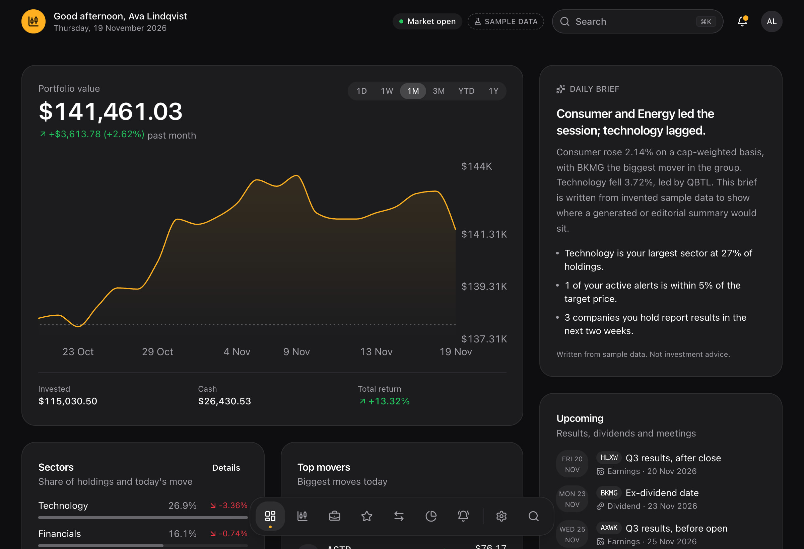

# Ledgerfinch · finance dashboard template

A dark, glassy finance and analytics dashboard, built as a static single-page app on TanStack Start (SPA
mode): portfolio value chart, markets
screener, instrument pages with a sample order ticket, watchlists, a transaction ledger, cash-flow reports,
price alerts and settings. Navigation is a floating dock at the bottom plus a ⌘K command palette.

> **Sample data only.** Every ticker, company, index, headline and price in this app is invented and
> generated from a seed. Nothing is real market data, nothing is investment advice, and the "buy / sell /
> add cash / connect account / change plan" controls only change an in-memory sample account in your tab.



## Run it

```bash
source ~/.nvm/nvm.sh && nvm use 24
pnpm --filter app-finance dev          # http://localhost:3006
pnpm --filter app-finance typecheck
pnpm --filter app-finance build        # static files in dist/client (index.html is the app shell)
pnpm exec biome check apps/app-finance
pnpm --filter app-finance preview:cf   # build, then serve dist/client the way Cloudflare will
pnpm --filter app-finance deploy       # build, then wrangler deploy
```

## Static SPA on TanStack Start

There is no server code. Everything (the sample account, the generated market data, the session) lives in
the browser, so the build is just files:

- `vite.config.ts` turns on SPA mode and writes the app shell (the root route: `<head>`, theme script, styles,
  no page content) to `dist/client/index.html`.
- `wrangler.jsonc` is an assets-only config: Cloudflare serves `dist/client`, and any address without a file
  (`/markets/NVRA`, `/settings/billing`, a typo) gets `index.html` (`not_found_handling: "single-page-application"`).
  No Worker runs per request.
- In the browser the router reads the address, runs the route's `beforeLoad` / `loader`, and renders the page.
  Unknown addresses render the app's own 404 page.

No sign-in is asked: you start as the sample user (see "Sign-in is off by default" below). Dark is the default theme; switch in the user menu,
Settings → Appearance, or the command palette.

## Screens

| Route | What it shows |
|---|---|
| `/sign-in`, `/sign-up`, `/forgot-password` | react-hook-form + zod, field errors, loading states |
| `/` Overview | Portfolio value chart (1D–1Y, crosshair tooltip), sectors with inline bars, top movers, daily brief, news feed, upcoming events |
| `/markets` | Sector heatmap and a TanStack Table v9 screener: sort, search, sector/cap/change filters, column visibility, sparklines, pagination |
| `/markets/$symbol` | Live sample quote, line/candle chart with ranges, key stats, about, related, watchlist menu, sample order dialog |
| `/portfolio` | KPI tiles, performance vs an invented benchmark, allocation donut, holdings table with P/L, sample cash top-up |
| `/watchlist` | Multiple lists, add/remove/reorder, sparkline rows, empty states |
| `/transactions` | Ledger with type/date/search filters, detail sheet, CSV export, "record a cash movement" dialog |
| `/reports` | KPI tiles, income vs spending bars, category breakdown, monthly table, period select, CSV export (PDF is a stub) |
| `/alerts` | Price alerts with live distance to target, create dialog, enable switch, delete with confirm |
| `/settings/*` | Profile, Appearance (theme, accent, number format, compact numbers, display currency), Notifications, Security (2FA stub, sessions), Connected accounts, Billing, Danger zone |

Plus route `pendingComponent` skeletons shaped like the charts, an error boundary with retry, an in-app and a
full-page 404, an instrument-specific "no such symbol" page, and toasts for every mutation.

## Where things live

```
src/
  routes/                 thin file routes: beforeLoad / loader / head + one page component
    __root.tsx            document shell, theme + accent pre-paint scripts, providers, 404
    _auth.tsx  _auth/     sign-in, sign-up, forgot-password (signed-in visitors go to /)
    _app.tsx   _app/      the signed-in area: guard + AppShell; markets/$symbol, settings/* …
  router.tsx              router + QueryClient (router context), default error boundary
  features/<feature>/     api/ (queries.ts, mutations.ts) · components/ · schemas/ · constants/ · hooks/ · utils/
  components/kit/         app design kit: Panel, Change, RangeTabs, skeletons, table helpers
  components/kit/charts/  PriceChart (area + candles), Sparkline/MeterBar, DonutChart
  components/layout/      AppShell, TopBar, Dock, user menu, session context
  lib/                    format.ts (Intl), preferences, csv, session (localStorage), query client
  lib/sample-data/        seeded generators and the in-memory sample account
```

## Plug in a real API

Every read goes through a `queryOptions` in `features/<feature>/api/queries.ts`, and every write through a
hook in `api/mutations.ts`. Replace the body of the `queryFn` / `mutationFn` with your fetch and keep the
query key and the zod schema; components do not change. Then delete `src/lib/sample-data/` and
`src/lib/delay.ts`.

- Route `loader`s call `queryClient.ensureQueryData(...)` (overview, markets, an instrument, reports), so
  those pages render with data and a link hovered with the mouse is preloaded. Other pages fetch in their
  components. "Live" prices come from `refetchInterval` (5 s, `LIVE_TICK_MS` in `lib/query-keys.ts`); a
  websocket can call `queryClient.setQueryData` instead.
- The sample account (holdings, cash, watchlists, transactions, alerts) lives in memory in the tab, so a
  full page reload resets it.
- URL state is validated route search params (zod): `/alerts?new=1&symbol=NVRA`,
  `/transactions?new=1`, `/sign-in?next=/markets/NVRA`.
- Cross-feature invalidation uses the shared roots in `lib/query-keys.ts` (a sample trade invalidates
  `["account"]`, which refreshes portfolio, transactions and overview together).

## Plug in real auth

Search for `PLUG REAL AUTH HERE`:

- `src/lib/session.ts` keeps the sample session (a display name and email) in localStorage. Swap its three
  functions for your provider's browser SDK: `readSession` → current user, `startSession` → sign-in /
  sign-up, `endSession` → sign-out.
- `src/routes/_app.tsx` guards the signed-in area in `beforeLoad`: no session → redirect to
  `/sign-in?next=<where you were>`. `src/routes/_auth.tsx` sends signed-in visitors from the auth pages to `/`.
- `src/features/auth/api/mutations.ts` holds the sign-in / sign-up / sign-out mutations that call those
  functions.

The guard only decides what the browser shows. With real data, your API must verify the provider's token
on every request; nothing in a static app is a security boundary.

## Add a chart or a screen

- **Chart**: use `PriceChart` for time series (pass `compare` for a second line, `mode="candle"` for OHLC),
  `DonutChart` for shares, `Sparkline` / `MeterBar` inline, or `ChartContainer` from `@repo/ui/components/chart`
  with recharts directly (see `features/reports`). Give every chart a text summary (`figcaption` or sr-only).
- **Screen**: create `features/<name>/` with `schemas/`, `api/queries.ts` and `components/<name>-page.tsx`,
  add `src/routes/_app/<name>.tsx` (`head` title, optional `loader`, the page component), and add a nav entry to
  `components/layout/nav-items.ts` so it appears in the dock and the command palette.

## Formatting and accessibility notes

- All numbers go through `useFormat()` (`lib/use-format.ts`) so the Appearance settings apply everywhere.
  Dates are formatted in UTC and sample data is anchored to a fixed date (19 Nov 2026), so every visitor sees
  the same strings whatever their time zone.
- Gains and losses always carry an arrow or sign and a screen-reader word, not colour alone.
- Motion is short and follows `prefers-reduced-motion` (`MotionConfig reducedMotion="user"`).

## Sign-in is off by default

`REQUIRE_SIGN_IN` in `src/lib/session.ts` is `false`, so the app opens straight away with a sample user and nobody is
asked to sign in. The sign-in screens are still at `/sign-in`. Set it to `true` when you plug real auth in.
