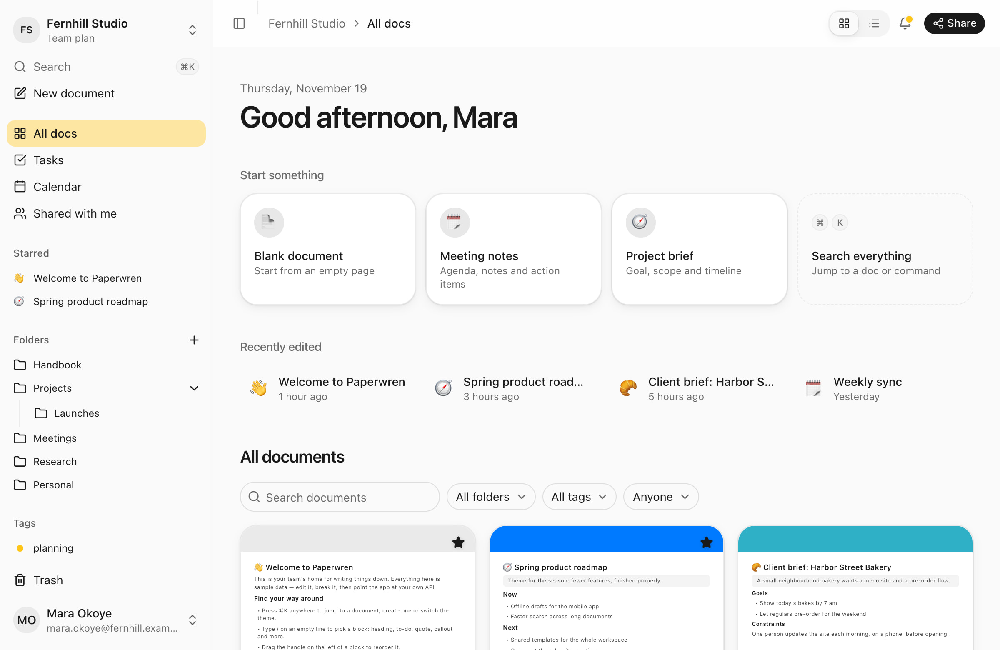
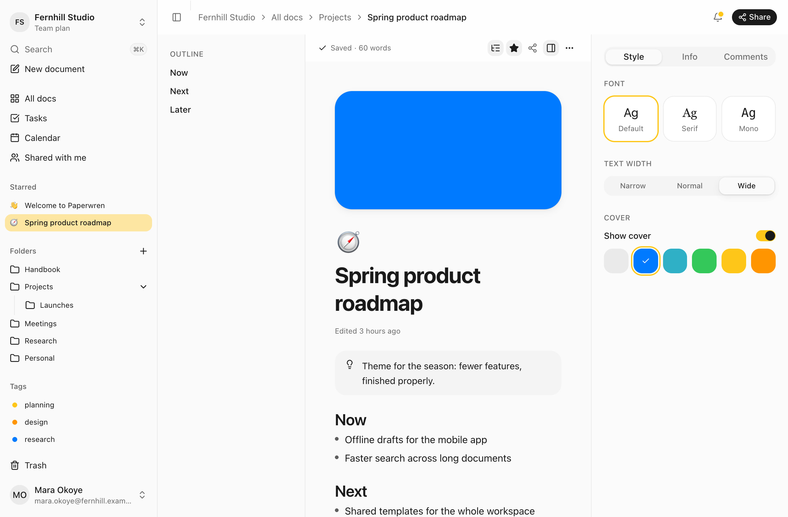
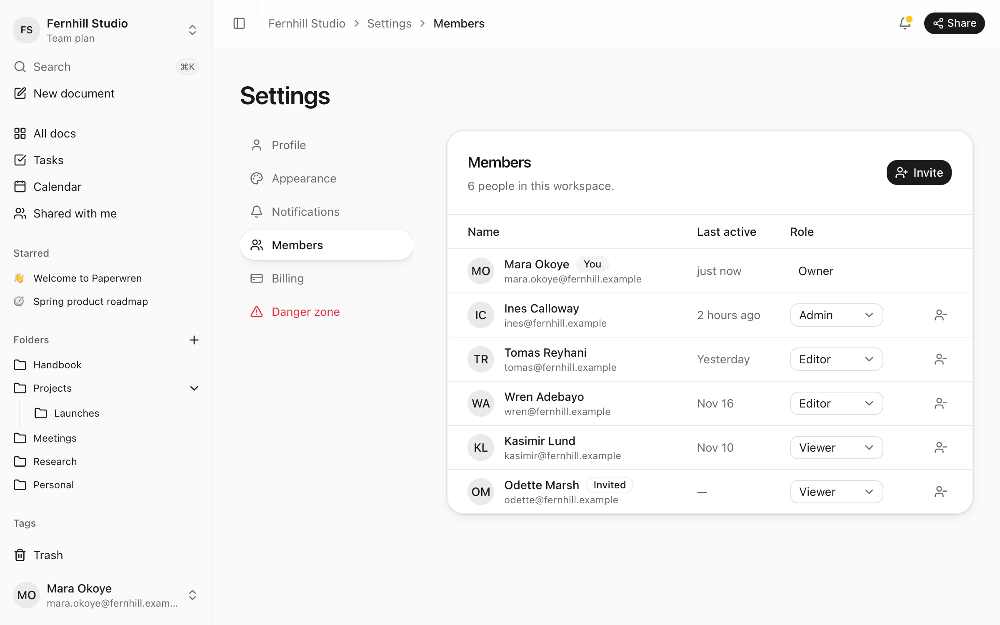

# app-workspace — Paperwren

A documents and notes workspace template (TanStack Start as a static single-page app, port 3004): a calm
light-first UI with a
collapsible sidebar, a document grid and table, a small block editor with an inspector, tasks, a calendar,
trash, settings and a first-run flow. "Paperwren" and the "Fernhill Studio" workspace are fictional; every
document, person and number is sample data.



## Run it

```sh
source ~/.nvm/nvm.sh && nvm use 24
pnpm install                      # once, from the repo root
pnpm --filter app-workspace dev   # http://localhost:3004
pnpm --filter app-workspace typecheck
pnpm --filter app-workspace build      # static files in dist/client (shell: dist/client/index.html)
pnpm exec biome check apps/app-workspace
pnpm --filter app-workspace preview:cf # build, then serve dist/client the way Cloudflare does
```

There is no server code. The build writes one shell page plus the JS and CSS; the router runs in the
browser, and `wrangler.jsonc` serves `dist/client` as static assets with no Worker script, sending the shell
for any address without a file (`not_found_handling: "single-page-application"`). Any static host works the
same way if it rewrites unknown paths to `/index.html`.

No sign-in is asked: you start as the sample user (see "Sign-in is off by default" below). Sample data is kept in your
browser's localStorage, so edits survive a reload; Settings → Danger zone → Reset sample data puts it back.

## Screens

| Route | What it shows |
|---|---|
| `/sign-in`, `/sign-up`, `/forgot-password` | react-hook-form + zod forms with field errors and loading states |
| `/onboarding` | 3 steps: name the workspace, pick a use, invite teammates (skippable) |
| `/` | Greeting, quick actions, recently edited, document collection (grid with previews, or TanStack Table list with sort, search, column visibility, row selection + bulk actions, pagination), filters by folder/tag/owner in the URL, empty and skeleton states |
| `/shared` | The same collection, scoped to documents other people own |
| `/docs/$docId` | Block editor (title, paragraph, headings, to-do, bullets, quote, callout, divider, image placeholder; `/` menu, `+` menu, drag handle, ⌥⇧↑/↓, markdown shortcuts), autosave status, word count, outline, inspector (font, width, cover; info, folder, tags; comments), share dialog, Markdown export |
| `/tasks` | Today / Upcoming / Done, quick add, edit dialog (due date, priority, linked doc) |
| `/calendar` | Month grid with event chips and task dots, day panel, add event dialog |
| `/trash` | Restore, delete forever, empty trash (with confirmation) |
| `/settings/*` | Profile, Appearance (theme, accent, density), Notifications, Members (invite, role, remove), Billing (plans, usage, invoices), Danger zone |

Global: ⌘K command palette, `N` new document, `?` shortcuts sheet, ⇧⌘L theme, ⌘B sidebar. Each route's
`pendingComponent`, `errorComponent` and `notFoundComponent` cover loading, error and 404 states; every
mutation reports with a toast.




## Structure

```
src/routes/              thin routes: beforeLoad / loader / head + one page component
  _auth.tsx, _auth/*     sign-in, sign-up, forgot-password (signed-in visitors are sent to /)
  _app.tsx, _app/*       the signed-in area: guard + app shell; settings.tsx is the settings layout
  onboarding.tsx         first-run flow (guarded, no shell)
src/router.tsx           router + QueryClient, default pending/error states
src/components/layout/   app shell: sidebar, top bar, shell context, shortcuts sheet, state screens
src/components/kit/      app design kit: avatars, tag pills, covers, radio cards, segmented control …
src/features/<feature>/  auth, documents, editor, tasks, calendar, search, sharing, members,
                         notifications, settings, onboarding, trash
  api/queries.ts         queryOptions (the only place data is read)
  api/mutations.ts       useMutation hooks with optimistic updates and toasts
  api/store.ts           sample data for the fake backend (delete when you plug in an API)
  schemas/               zod schemas; types are z.infer of them
  components/ hooks/ utils/ constants/
src/lib/                 cross-feature helpers: session, fake backend, appearance, formatting
```

Features talk to each other only through another feature's `api/` and `schemas/` (its data contract),
never through its components or hooks. The shell in `components/layout/` composes features.

## Plug in a real API

1. Replace the body of each `queryFn` in `features/*/api/queries.ts` with a call to your API and keep the
   zod `parse`. Query keys and shapes stay the same, so components do not change.
2. Replace each `mutationFn` in `features/*/api/mutations.ts`. The optimistic `onMutate` / rollback code
   works as is.
3. Delete `features/*/api/store.ts` and `src/lib/mock-db.ts`.
4. Route `loader`s call `queryClient.ensureQueryData(...)` with the same queryOptions (see
   `routes/_app/index.tsx`, `routes/_app/docs/$docId.tsx`, `routes/_app/settings/billing.tsx`), so a page opens
   with its data; with a real API they keep working unchanged.

## Plug in real auth

The sample session lives in the browser only: `src/lib/session.ts` keeps the signed-in user in
localStorage. It is a demo convenience, not security; your API must check your provider's token on every
request. Search for `PLUG REAL AUTH HERE`:

- `src/lib/session.ts` — swap `getSession`, `startSession`, `updateSessionUser` and `endSession` for your
  provider's browser SDK (current user, sign in, update profile, sign out).
- `src/features/auth/api/mutations.ts` — sign in, sign up and password reset calls.

The guards only call `getSession()`: `routes/_app.tsx` and `routes/onboarding.tsx` redirect to
`/sign-in?next=…` without a session, and `routes/_auth.tsx` sends signed-in visitors to `/`.

## Add a feature

1. `src/features/<name>/schemas/<thing>.ts` — the zod schema.
2. `api/queries.ts` (queryOptions) and `api/mutations.ts` (useMutation) — start with an in-memory store via
   `createCollection` from `lib/mock-db.ts`, swap later.
3. `components/<name>-page.tsx` — the screen; use `PageContainer` / `PageHeader` from `components/kit`.
4. `src/routes/_app/<name>.tsx` — `createFileRoute` with `head` (title), an optional `loader`, and
   `component: NamePage`, nothing else.
5. Add it to `NAV` in `components/layout/app-sidebar.tsx` and `PAGES` in
   `features/search/components/command-palette.tsx`.

## Sign-in is off by default

`REQUIRE_SIGN_IN` in `src/lib/session.ts` is `false`, so the app opens straight away with a sample user and nobody is
asked to sign in. The sign-in screens are still at `/sign-in`. Set it to `true` when you plug real auth in.
