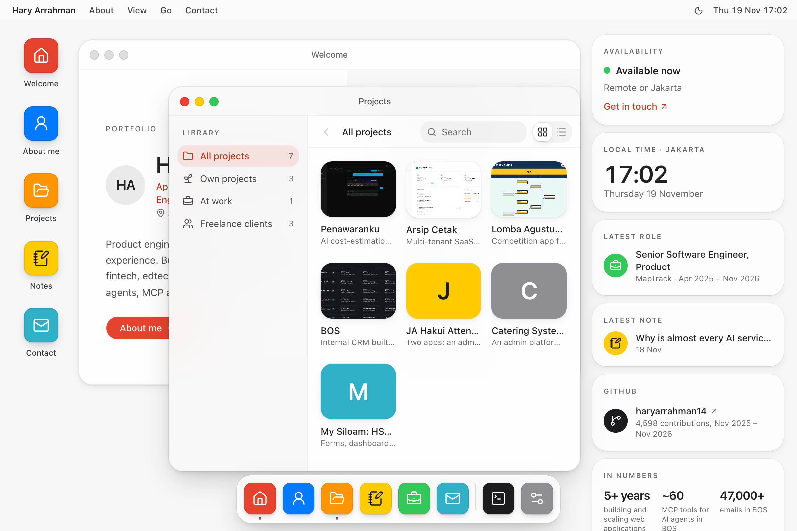

# portfolio-desktop

A personal portfolio that *is* a laptop desktop: menu bar, wallpaper, desktop icons, widgets, a glass dock
and draggable windows for About, Projects, Notes, Experience, Contact, Terminal and Settings.
TanStack Start (SSR), React 19, Tailwind v4, `@repo/ui`, TanStack Query, zod, react-hook-form, motion.



## Run

```sh
source ~/.nvm/nvm.sh && nvm use 24
pnpm --filter portfolio-desktop dev        # http://localhost:3001
pnpm --filter portfolio-desktop typecheck
pnpm --filter portfolio-desktop build
pnpm exec biome check apps/portfolio-desktop   # from the repo root
```

## Routes

One route, `/`. The window in front is mirrored in the search param, so links are shareable:
`/?app=projects`, `/?app=notes`, … (validated with zod in `features/windows/schemas/desktop-search.ts`;
unknown values are ignored). The Welcome window always opens on first load and is server-rendered, so the name,
title and pitch are in the HTML; `routes/index.tsx` also sets the title and description (the first summary
paragraph) from the profile.

## Replace the content

All facts come from `packages/content` (`@repo/content`): profile, skills, story, experience, education,
projects, screenshots (`proof`), GitHub figures and the blog posts in `packages/content/posts/*.md`. To reuse this
template, replace that package's data; the app has no facts of its own.

Each feature's `api/queries.ts` reads the package and maps it to the feature's zod schema in `schemas/`:

| What | File | From `@repo/content` |
|---|---|---|
| Name, title, pitch, summary, skills, story, links | `src/features/about/api/queries.ts` | `profile`, `skillGroups`, `story` |
| Projects (file browser window) | `src/features/projects/api/queries.ts` | `projects`, BOS from `experiences`, freelance client projects |
| Notes (Markdown) | `src/features/notes/api/queries.ts` | English posts in `posts/*.md` (frontmatter + Markdown) |
| Work history, education, CV link | `src/features/experience/api/queries.ts` | `experiences`, `education`, `profile.cv` |
| Widgets: availability, latest role, GitHub, numbers | `src/features/desktop/api/queries.ts` | `profile`, `experiences`, `github`, `keyFigures` |
| Contact form sending (simulated, sends nothing) | `src/features/contact/api/mutations.ts` | |
| App names, icons, tile colours, window sizes | `src/lib/apps.ts` | |
| Wallpapers and accent colours | `src/lib/preferences.tsx` | |

Files in `public/`: the CV PDF (`public/cv/`, linked from `profile.cv.href`) and the screenshots the Projects
window shows (`public/proof/`, the `-800.webp` copies of the paths in `proof`). Replace them with your own.
A widget or field with no fact behind it is left out rather than filled in.

To use a real backend, change only the `queryFn`/`mutationFn` bodies; components read through TanStack Query.
The avatar is an initials placeholder (`components/kit/initials-avatar.tsx`); swap in an `` when you have a
photo. Projects without screenshots get a flat placeholder (`features/projects/components/project-thumb.tsx`).

## How it fits together

- `src/lib/window-store.tsx`: the window manager (context + reducer): open, focus/z-order, move, resize,
  minimise, maximise, close; Escape closes the focused window.
- `src/features/windows`: the window frame (title bar drag, edge resize, round controls) and the layer.
- `src/features/desktop`, `dock`, `menu-bar`: the shell pieces. The dock magnifies on hover unless reduced
  motion is on (system setting or Settings → Reduce motion).
- `src/components/layout/desktop-page.tsx`: composes the shell and keeps `?app=` in sync with the front window.
- `src/components/layout/app-registry.tsx`: maps each app id to its window content.
- Under 768px, windows become full-width sheets (no dragging), the dock becomes a scrollable bottom bar and the
  desktop shows every app plus the widgets stacked.

## Add a new app / window

1. Add the id to `APP_IDS` and its meta (title, hint, lucide icon, gradient, size) to `APPS` in `src/lib/apps.ts`.
   Add it to `DOCK_APPS` / `DESKTOP_APPS` if it should appear there.
2. Create `src/features/<name>/components/<name>-app.tsx` (plus `api/`, `schemas/` if it has data).
3. Return it from `renderApp` in `src/components/layout/app-registry.tsx`. TypeScript flags the missing case.
4. If it has data, prefetch its query in the loader in `src/routes/index.tsx` so it renders on the server.

The menu bar's Go menu, the dock, the terminal's `open <app>` and the `?app=` deep link pick it up automatically.
