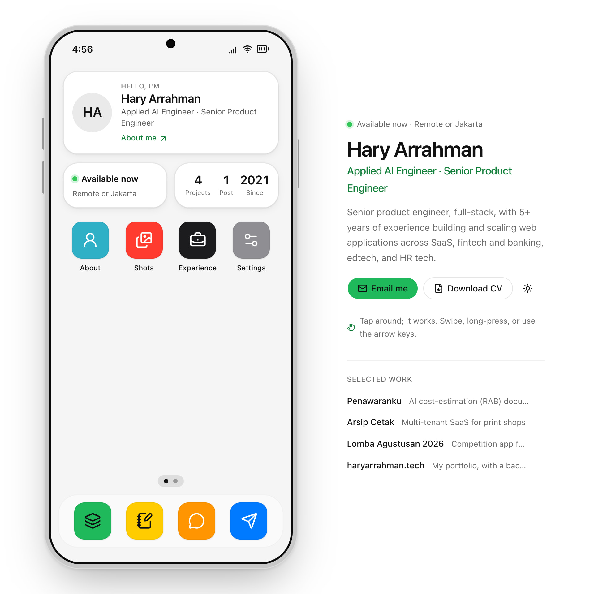
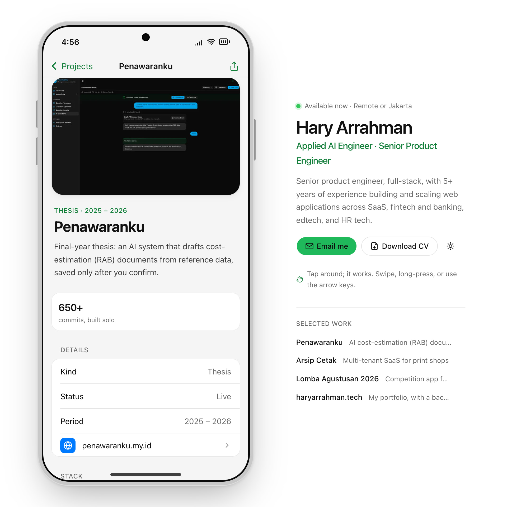

# portfolio-phone

A portfolio that is a phone. On a desktop or tablet the visitor sees a generic phone beside a short intro
(name, role, pitch, Email / Download CV / theme). On a real phone the frame disappears and the screen fills
the viewport. Lock screen → home screen with widgets and a dock → apps that open full-screen.

TanStack Start · React 19 · Tailwind v4 · `@repo/ui` · TanStack Query · zod · react-hook-form · motion.




## Run

```sh
source ~/.nvm/nvm.sh && nvm use 24
pnpm --filter portfolio-phone dev        # http://localhost:3002
pnpm --filter portfolio-phone build
pnpm --filter portfolio-phone typecheck
pnpm exec biome check apps/portfolio-phone
```

## How it works

- One route, `/`. The open app and item live in the URL: `/?app=projects&id=penawaranku`
  (validated by `phoneSearchSchema` in `src/lib/phone-nav.ts`). Every link is shareable, and the browser's
  back button and the phone's back button walk the same history.
- The page is server-rendered: name, role, pitch and a plain project list are real HTML in the side panel
  (visually hidden on phones), and `<title>`/description follow the deep link.
- Lock screen: swipe up, tap, or press Enter. The unlock is remembered for the browser session.
  The frame's right side button locks the phone again (so does Settings → Lock phone).
- Home: swipe/drag or ←/→ between two pages, right-click or long-press an icon for Open / Share link.
- Apps zoom out of the icon that opened them. Esc goes back one level; the home bar (tap or swipe up) goes home.
- Settings → theme, wallpaper, accent and reduced motion are saved in `localStorage` and applied before
  first paint (`preferencesScript` in `src/lib/preferences.tsx`).

## Replace the content

All content comes from `packages/content` (`@repo/content`), the owner's portfolio content package:
`profile.ts`, `experience.ts`, `projects.ts`, `proof.ts`, `cv.ts` and the Markdown posts in `posts/*.md`.
To reuse the template, replace that package's data (and the files in `public/`); this app's code stays.

Each feature reads it in one `api/queries.ts`, mapped onto a zod schema next to it in `schemas/`. To use a
real API instead, swap that file's `queryFn`. A slot whose fact is missing from the package hides itself.

| What | Read from | Mapped in |
|---|---|---|
| Name, headline, summary, availability, skills, education, key figures, links | `profile.ts` | `src/features/about/api/queries.ts` |
| Experience timeline, CV link (`profile.cv.href` → `public/cv/`) | `experience.ts`, `profile.ts` | `src/features/experience/api/queries.ts` |
| Projects (list + detail, metrics, stack, gallery) | `projects.ts`, `proof.ts` | `src/features/projects/api/queries.ts` |
| Notes (English posts; `lang: id` translations are left out) | `posts/*.md` | `src/lib/content.ts`, `src/features/notes/api/queries.ts` |
| Shots (every real screenshot) | `proof.ts` via projects and experiences | `src/features/photos/api/queries.ts` |
| "Ask me" questions and answers | `profile.ts`, `experience.ts`, `projects.ts` | `src/features/messages/api/queries.ts` |
| Contact links and time zone; the fake send | `profile.ts` | `src/features/contact/api/queries.ts`, `api/mutations.ts` |
| Lock-screen notifications | counted from the package | `src/features/lock-screen/api/queries.ts` |
| Home widgets (stats, featured project, latest post) | counted from the package | `src/features/home-screen/api/queries.ts` |
| App names, icons, tile colours, dock | — | `src/lib/apps.ts` |
| Project tile art (glyph + colour per slug) | — | `src/lib/icons.ts` |
| Wallpapers (CSS) and accent hues | — | `src/styles/app.css`, `src/lib/preferences.tsx` |

Screenshots: `proof.ts` names `/proof/<slug>/<name>.webp`; the app serves the `-800.webp` (web) and
`-400.webp` (phone) copies from `public/proof/`. The contact form validates with zod but sends nothing: put
your backend call in `sendContactMessage`.

## Add an in-phone app

1. `src/lib/apps.ts`: add the id to `APP_IDS`, an entry in `APPS` (label, lucide icon, tile gradient), and put it
   in `DOCK_APPS` or `PAGE_ONE_APPS`.
2. Create `src/features/<id>/` with `components/<id>-app.tsx` (and `api/queries.ts` + `schemas/` for its content).
   Wrap the view in `AppScreen` from `components/kit/app-screen.tsx`, use `InsetSection`/`InsetRow` for grouped
   lists, and `usePhoneNav()` for `open(app, id)` / `back()`. For list → detail, render inside `PushView`.
3. `src/components/layout/app-views.tsx`: add a `case` that renders it.
4. If it has data, add its `ensureQueryData` to the loader in `src/routes/index.tsx` so it's server-rendered.

## Structure

```
src/
  routes/                 index.tsx (search schema, loader, head) · __root.tsx
  components/layout/      phone-page.tsx (composes the phone) · app-views.tsx (app id → feature)
  components/kit/         app-screen, inset-list, push-view, app-tile
  lib/                    apps, content (posts, screenshot paths), phone-nav, preferences, share, icons, format, use-now
  features/
    device/               frame, status bar, side panel
    lock-screen/          clock, notifications, swipe to unlock
    home-screen/          pages, widgets, icons with context menu, dock
    app-shell/            zoom-from-icon layer, home indicator, Esc
    about/ projects/ notes/ photos/ messages/ contact/ experience/ settings/
```

The content is the owner's real portfolio, from `packages/content`.
