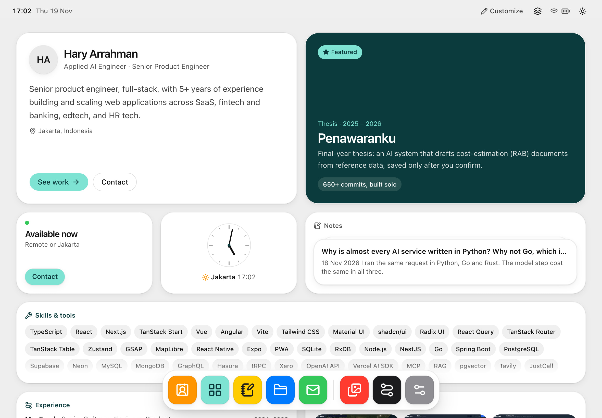
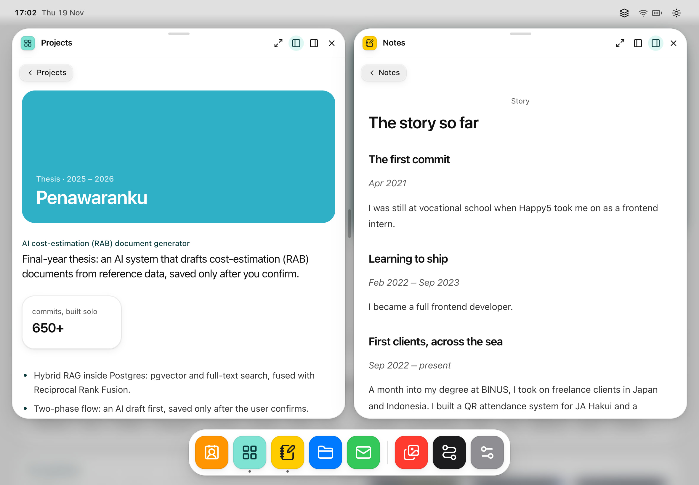

# portfolio-tablet

A portfolio that is a tablet home screen. The home is a bento grid of widgets (profile, featured project,
availability, local time, notes, skills, experience, key figures, gallery) above an app grid and a floating glass
dock. Apps open as large sheets, two can sit side by side in split view, and an app switcher shows what you opened.
Light and dark, tablet first, usable on phones. The content is Hary Arrahman's real portfolio, read from
`packages/content`.




## Run

```sh
source ~/.nvm/nvm.sh && nvm use 24
pnpm install
pnpm --filter portfolio-tablet dev        # http://localhost:3003
pnpm --filter portfolio-tablet build
pnpm --filter portfolio-tablet typecheck
pnpm exec biome check apps/portfolio-tablet
```

## What's where

| Path | What |
|---|---|
| `src/routes/index.tsx` | The only route: search params (zod), preloads all content, title/description meta |
| `src/components/layout/tablet-shell.tsx` | The whole screen: status bar, widgets, apps, stage, dock, switcher |
| `src/components/layout/app-registry.tsx` | Which component renders each app; preloads every feature's query for SSR |
| `src/components/layout/home-widgets.tsx` | Wires each widget to its data and to the app it opens; default widget order |
| `src/components/kit/` | App design kit: app icon tile, avatar, gradient placeholder, master-detail split, markdown, page parts |
| `src/features/home` | Widget grid with edit mode (drag or arrow keys, reset), app icon grid |
| `src/features/widgets` | Widget components and home-only content |
| `src/features/dock` | Floating dock (tablet/desktop), bottom tab bar (phone) |
| `src/features/stage` | Open-app sheets, split view, divider, title-bar controls, app switcher |
| `src/features/{about,projects,notes,files,gallery,contact,experience,settings}` | One folder per app |
| `src/lib/` | App list, URL schema, preferences, local store, gradients, formatting |
| `src/styles/app.css` | Accent colours and CSS-only wallpapers |

## URL

The layout is in the URL, so it can be shared and browser Back closes what was just opened:

```
/?app=projects&id=penawaranku                                                  Projects, Penawaranku selected
/?app=projects&id=penawaranku&split=notes&sid=why-ai-services-use-python      Projects beside Notes
/?app=notes&split=projects&ratio=70                Notes 70%, Projects 30% (ratio: 30 | 50 | 70)
```

Invalid params are dropped, never an error. On phones `split` is ignored and one app shows full screen.

## Replace the content

All content comes from `packages/content` (`@repo/content`): `profile.ts`, `experience.ts`, `projects.ts`,
`proof.ts` (screenshots), `story.ts`, `cv.ts` and the markdown posts in `posts/`. To reuse the template, replace
that package's data; nothing in this app holds facts of its own. Each feature's `api/queries.ts` maps the package
into the zod schema in `features/<feature>/schemas/`; to use a real API, change only the `queryFn`.

| What | Reads | Mapped in |
|---|---|---|
| Name, headline, summary, links, skills, story, education | `profile`, `skillGroups`, `story`, `education` | `features/about/api/queries.ts` |
| Projects (first `featured: true` fills the featured widget) | `projects` | `features/projects/api/queries.ts` |
| Notes: English blog posts and the story | `posts/*.md`, `story` | `features/notes/api/queries.ts` (posts via `lib/blog-posts.ts`) |
| Files: the CV PDF, the posts, a write-up per project | `profile.cv`, `posts/*.md`, `projects` | `features/files/api/queries.ts` |
| Gallery: every screenshot | `experiences[].gallery`, sections, `projects[].gallery` | `features/gallery/api/queries.ts` |
| Experience and the CV download | `experiences`, `education`, `profile.cv` | `features/experience/api/queries.ts` |
| Contact details; the fake send | `profile` | `features/contact/api/queries.ts`, `api/mutations.ts` |
| Availability, key figures, clock city | `profile`, `keyFigures` | `features/widgets/api/queries.ts` |
| Accent colours and wallpapers | | `src/styles/app.css` plus `src/lib/preferences.ts` |

Files the content points at live in `public/`: the CV PDF at `public/cv/` and the screenshots (800px variants) at
`public/proof/<slug>/<name>-800.webp` (`lib/proof.ts` maps a `proof.ts` path to them). A widget or field the
content has no fact for is left out rather than filled in. The contact form sends nothing: replace
`sendContactMessage` with a real request.

## Add a widget

1. Write the component in `features/widgets/components/`, wrapped in `WidgetShell` (whole card opens an app).
   Put any home-only content in `features/widgets/api/queries.ts` and its schema.
2. Add an entry in `components/layout/home-widgets.tsx`: `id`, `label`, `size` (`small` 1×1, `medium` 2×1,
   `large` 2×2, `wide` 4×1) and `node`. Its place in the array is its default position.

Saved layouts adapt by themselves: unknown ids are dropped, new widgets are appended.

## Add an app

1. Add the id and its meta (name, lucide icon, hue) to `src/lib/apps.ts`; add it to `DOCK_APPS` to pin it.
2. Create `features/<app>/` with `api/queries.ts`, `schemas/` and `components/<app>-page.tsx`. The page takes
   `AppViewProps` (`itemId`, `onItemChange`, `openApp`). Size it with container queries (`@container`), since a
   pane can be 30% wide; `components/kit/master-detail.tsx` handles sidebar + detail for you.
3. Register it in `components/layout/app-registry.tsx` (`APP_VIEWS`, and its query in `preloadContent`).

## Keys

`` ` `` toggles the app switcher, `Esc` closes apps (or the switcher, or edit mode), arrow keys move a focused
widget in edit mode and the split divider when focused.
